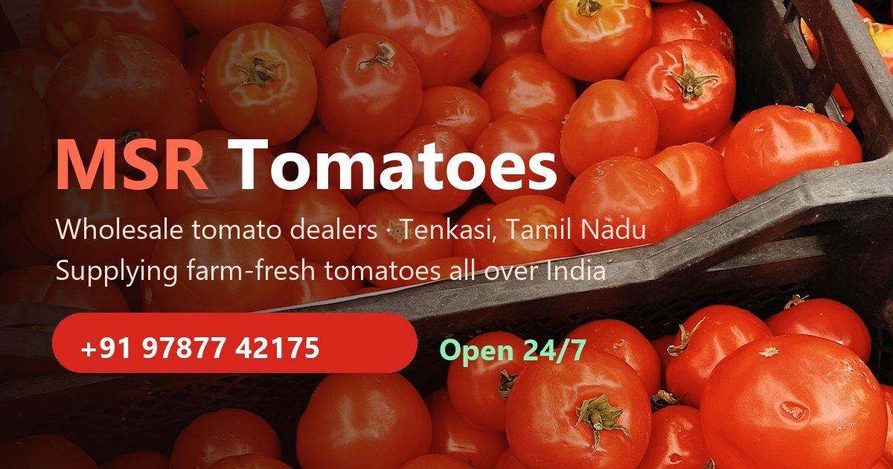

# MSR Tomatoes

Website for **MSR Tomatoes**, wholesale tomato dealers based in **Tenkasi, Tamil Nadu**, supplying farm-fresh tomatoes in bulk all over India.

**▶ Live site:** https://mahesh21723.github.io/MSR-TOMATOES/  ·  Tamil: https://mahesh21723.github.io/MSR-TOMATOES/?lang=ta



## Features

- **3D hero:** a glossy, procedurally modelled tomato (Three.js) with calyx, stem, companion tomatoes and drifting leaves. It reacts to the mouse and to scrolling, pauses when off-screen, and respects reduced-motion settings.
- **English / Tamil:** every text switches with one tap. The choice is remembered, and `?lang=ta` links open straight in Tamil.
- **Call and WhatsApp everywhere:** tap-to-call, WhatsApp with a ready message, and floating action buttons.
- **WhatsApp enquiry form:** name, city, quantity and variety are sent as a pre-filled WhatsApp message, so no server is needed.
- **Animated supply map:** routes from Tenkasi to major markets across India.
- **Google Maps** location with directions, and an "Open 24 hours" status.
- **Responsive and fast:** mobile-first layout, lazy-loaded images, scroll-reveal animations, and SEO meta tags with `LocalBusiness` structured data.

## Contact details used on the site

| | |
|---|---|
| Phone / WhatsApp | +91 97877 42175 |
| Email | kmaheshwaran9965@gmail.com |
| Location | Tenkasi, Tamil Nadu ([Google Maps](https://maps.app.goo.gl/TBw7mvq84U39yLVB8)) |
| Hours | Open 24 hours, all days |

## Structure

```
index.html              page markup, SEO tags, icon sprite
assets/css/style.css    design system and responsive layout
assets/js/main.js       translations, navigation, reveal effects, route map, WhatsApp form
assets/js/tomato3d.js   Three.js 3D hero
assets/img/             photos (see CREDITS.md), favicon, social image
```

Plain HTML, CSS and JavaScript, with no build step. To run it locally, use any static server, for example `python -m http.server`, and open http://localhost:8000.

## Photos

Free stock photos from Pexels and Unsplash (free for commercial use). Credits are in [assets/img/CREDITS.md](assets/img/CREDITS.md). To use your own photos, replace the files in `assets/img/` and keep the same names.

## Author

Website by **Maheshwaran**: [kmaheshwaran9965@gmail.com](mailto:kmaheshwaran9965@gmail.com) · [github.com/MAHESH21723](https://github.com/MAHESH21723)
